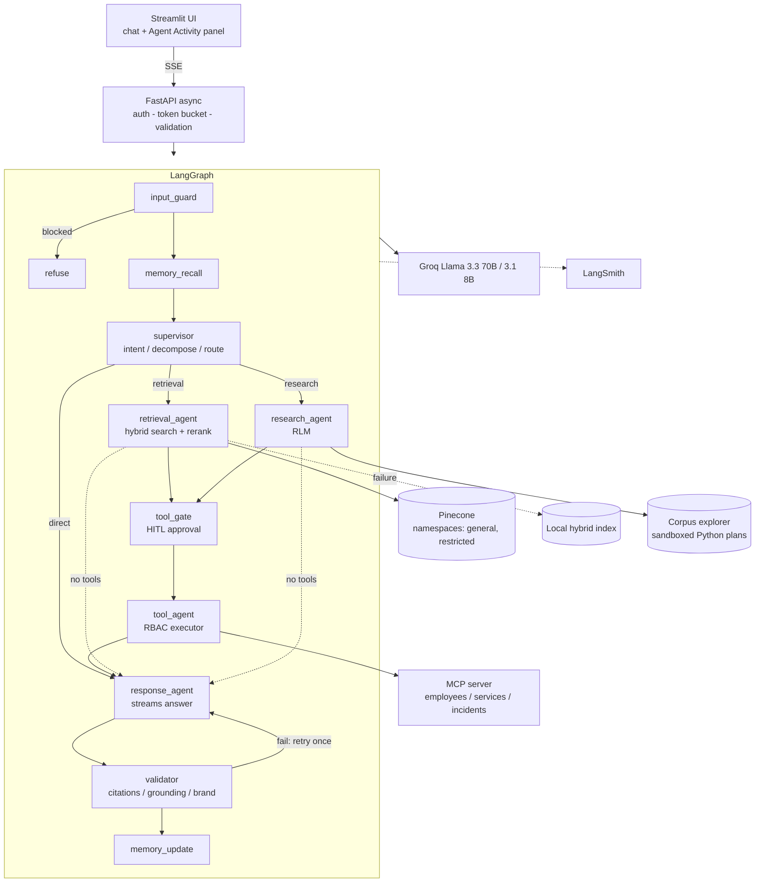

# Crest Assistant - Enterprise Agentic AI Knowledge Assistant

An enterprise assistant for **Crestline Commercial Bank** (fictional) that answers questions over internal documents using a
LangGraph multi-agent graph, hybrid RAG (Pinecone dense + BM25 sparse), a simplified Recursive Language Model (RLM),
RBAC-enforced tools (incl. an MCP server), guardrails, and full LangSmith tracing. LLM: **open-source Llama via Groq**.

## Quick start

```bash
python -m venv .venv && source .venv/bin/activate   # Python 3.11+
pip install -r requirements.txt
cp .env.example .env                                  # add GROQ_API_KEY, LANGSMITH_API_KEY (+ PINECONE_API_KEY)
python -m scripts.generate_sample_docs                # 25 mock documents -> data/docs
python -m scripts.ingest                              # optional: index to Pinecone (skip => local hybrid index)
uvicorn app.main:app --port 8000                      # terminal 1
streamlit run ui/streamlit_app.py                     # terminal 2  (http://localhost:8501)
# or: docker compose up --build
```
Users (password `demo123`): `viewer1`, `analyst1`, `admin1`. Tests: `pytest`.
Commit history: `bash scripts/git_commits.sh` (or commit as you go).

## Architecture



## How the requirements are met

| Area | Implementation |
|---|---|
| Agents / LangGraph | 7 specialised nodes, conditional routing, retry loop, `interrupt()` HITL, checkpointer (`app/agents/graph.py`) |
| Activity panel | Nodes emit custom stream events (`get_stream_writer`) + `updates` events -> SSE -> Streamlit (state, active node, tool calls, retrieval, memory, validation, final) |
| RAG | Pinecone single-index hybrid: `score = a*dense + (1-a)*BM25`, `a=HYBRID_ALPHA`; namespaces, metadata filters, per-document attribution, light reranker (`app/retrieval/store.py`) |
| RLM | LLM *writes a Python search plan* -> AST-validated sandbox -> batches -> parallel sub-agent map -> **recursive tree reduce** (`app/rlm.py`) |
| Memory | Window + rolling summary + long-term user facts (below) |
| Tools | `knowledge_search`, `python_analysis`, `mcp_query` (stdio MCP), `admin_reindex` (HITL) |
| Security | Input/retrieved/output guardrails, RBAC at 3 layers, token bucket (`app/security.py`, `auth.py`, `tools.py`, `rate_limit.py`) |
| Observability | LangSmith auto-tracing of graph/LLM + `@traceable` on retrieval, tool, RLM; metadata (user, role, session); structured JSON logs |
| Bonus | Multi-agent failure handling, HITL node, reranker, long-term memory, feedback loop (`/feedback` -> JSONL + LangSmith feedback), Docker Compose |

## Key design decisions

**Model choice.** `openai/gpt-oss-120b` (Groq) for planning RLM code, reduce steps and final answers - strongest open model on Groq for
instruction following and JSON. `openai/gpt-oss-120b` for routing, map sub-agents, fact extraction - 5-10x cheaper/faster, and these tasks are
narrow. Each role falls back to the other model on failure. Open weights keep data-residency options open (self-host later).

**Hybrid retrieval.** Groq has no embedding API, so dense vectors come from `all-MiniLM-L6-v2` (local, 384-d); sparse from `pinecone-text` BM25.
Pinecone hybrid needs a `dotproduct` index with alpha-weighted query vectors, so dense/sparse are combined server-side. The local fallback computes
min-max-normalised dense + BM25 scores explicitly and exposes both. Namespaces separate `restricted` (confidential) from `general`, so lower roles
never even query restricted vectors.

**RLM.** The model sees an API description, not documents. Plans are Python but run in a sandbox: AST allow-list (no imports, loops-while, dunder
or unknown attributes), restricted builtins, a corpus object already bound to the caller's role, 5s timeout. Failures (bad plan, LLM down) fall back to
hybrid search. Failed map batches are skipped and reported ("N batches failed") - partial results with disclosure beat a total failure.

**Memory.** (1) last 6 messages verbatim for follow-ups, (2) older turns compressed into a ~120-word summary so the prompt stays bounded, (3) durable
user facts (role/team/preferences) extracted only when the message looks like it contains one, persisted per user and recalled by overlap.
Keys are `user:session`, so sessions are isolated. Production: Redis for sessions, Pinecone namespace/Postgres for long-term facts.

**Multi-agent state & failure ("butterfly effect").** One typed state; each node returns only the keys it owns. Failures become *data* (`retrieval_note`,
`tool_results[].error`, `research.stats.failed`, `denied_tools`) that the response agent must disclose, instead of exceptions that cascade. Every
external dependency has a degraded mode: Groq down -> model fallback -> extractive answer; Pinecone down -> local index; MCP down/timeouts -> tool
error reported; invalid LLM JSON -> heuristic routing.

## Security model

| Threat | Control |
|---|---|
| Instruction override / jailbreak | Pattern guard on input (`check_user_input`); persona/rules fixed in system prompt; Unicode normalisation + zero-width stripping |
| Data exfiltration | Exfil patterns on input; output redaction of keys/card numbers; system-prompt-leak check; no network tools |
| Tool abuse | LLM only *proposes*; `ToolExecutor` enforces RBAC, Pydantic schema, MCP param allow-list + charset, timeout; `admin_reindex` needs human approval |
| Indirect injection (in documents) | `sanitize_retrieved` removes instruction-like sentences; docs wrapped in `<document>` tags declared untrusted. Try doc `RB-099` |
| Unauthorized access | Filters derived from the authenticated Principal (never from LLM output); namespace isolation; tool re-check |
| Hallucinated citations | Every `[DOC-ID]` must be in retrieved/researched ids; invalid ones stripped, answer regenerated once |
| Brand | Banking persona, blocks promissory financial language |

Pattern matching is intentionally the *cheap* layer; the structural controls above hold even if the model is fooled. Production hardening: a
classifier-based guard (e.g. Llama Guard on Groq), subprocess/container isolation for RLM plans.

## RBAC matrix

| | Viewer | Analyst | Admin |
|---|---|---|---|
| Chat + knowledge search | yes | yes | yes |
| Python analysis / MCP tools | no | yes | yes |
| Re-index (HITL) | no | no | yes |
| Document levels | public | public, internal | + confidential |

## LangSmith
Set `LANGSMITH_TRACING=true`, `LANGSMITH_API_KEY`, `LANGSMITH_PROJECT`. Each turn is one trace named `crest_assistant_turn` with child spans per node,
LLM call, `hybrid_search` (retriever), `tool_execute` (tool) and `rlm_*` chains. The final UI event carries `trace_id`; thumbs up/down are attached to it.

## Assumptions & trade-offs
- Auth is hardcoded users + in-memory tokens (Option A); Keycloak/OIDC is the production swap, `Principal` stays the same.
- In-memory rate limiter, sessions, and checkpointer: fine for one process; use Redis/Postgres checkpointer for scale-out.
- MCP server is spawned per call over stdio (simple, slow); production would keep a pooled session.
- Reranker is lexical/diversity based; a cross-encoder would improve precision at extra latency.
- "Last year" is resolved relative to the system date (2025 for the demo data).
- Groq free-tier rate limits are the main throughput limit; RLM map calls are throttled with a semaphore (3).
- Not exhaustively load-tested; unit tests cover guards, RBAC, rate limiting and sandbox. Integration run needs live Groq/Pinecone keys.

## Demo script (45 min plan)
1. Architecture walk-through (diagram above) - 8 min. 2. Login as viewer: search, show denied MCP/analysis tool - 5 min.
3. Analyst: RLM question on payment outages; watch plan -> batches -> reduce in the activity panel, then open the LangSmith trace - 12 min.
4. Injection attempts: direct (`Ignore previous instructions...`), indirect (RB-099) - 5 min. 5. Admin: re-index with approval - 4 min.
6. Failure modes: unset `PINECONE_API_KEY`/bad Groq key, rate-limit burst - 6 min. 7. Assumptions & trade-offs - 5 min.
